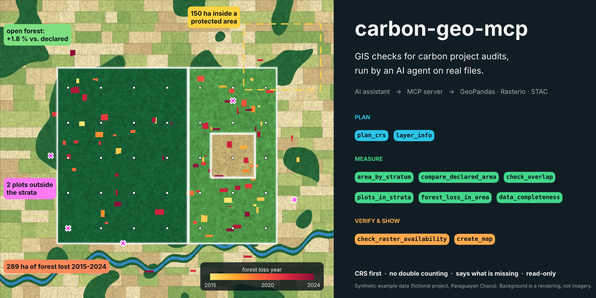
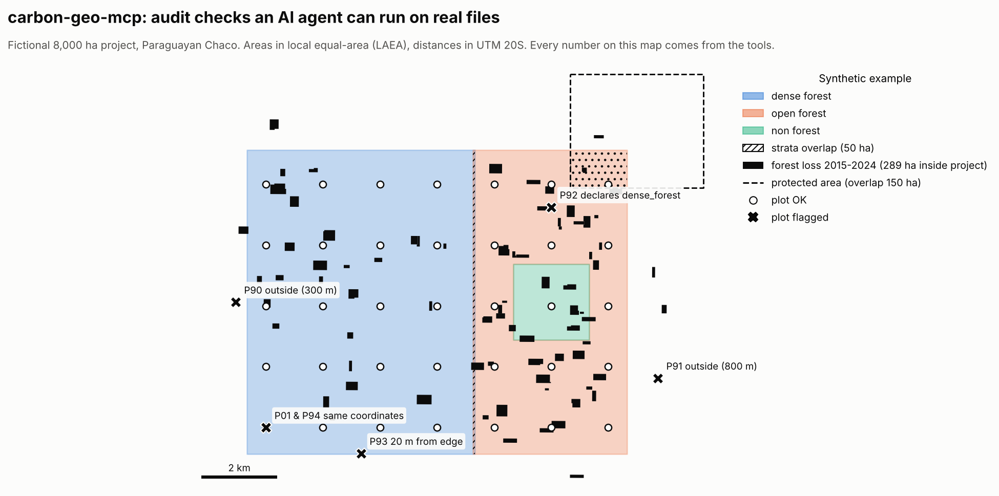

# carbon-geo-mcp



[](https://github.com/albertolozada/carbon-geo-mcp/actions/workflows/tests.yml)
[](https://colab.research.google.com/github/albertolozada/carbon-geo-mcp/blob/main/notebooks/01_analysis.ipynb)
[](LICENSE)

**An MCP server that lets an AI assistant run the GIS checks a carbon project auditor runs, on real files, instead of guessing numbers.**

Ask a chatbot "how many hectares does this project have?" and it will answer with confidence without opening a single file. With this server connected, the assistant calls real geoprocessing (GeoPandas, Shapely, PyProj, Rasterio), gets the answer back as data and explains it, always saying **which CRS it used** and **what was missing**.

## Question

Can an AI assistant be trusted with the routine spatial checks of a REDD+, ARR or IFM validation or verification (areas, overlaps, plots, forest loss) if it is given proper tools and the same rules an auditor follows?

## Tools

| Tool | What it checks | Typical audit question |
|---|---|---|
| `plan_crs` | CRS "reflection" before measuring: CRS, datum and UTM zones of every layer, suspicious coordinates, proposed CRS for areas and distances with the reason, UTM area distortion | "Are these layers where they should be, and in which CRS should I measure?" |
| `layer_info` | CRS (and whether it is in degrees), geometry problems, fields, bounds | "Is this shapefile usable as delivered?" |
| `area_by_stratum` | Hectares per stratum in an equal-area CRS, dissolving overlaps, reporting overlap within and between strata | "How large is each stratum really?" |
| `compare_declared_area` | Declared vs. calculated hectares, with a tolerance | "Do the areas in the PD match the shapefile?" |
| `check_overlap` | Overlap between two polygon layers, in ha and %, with the largest pairs | "Does the project overlap a protected area or another project?" |
| `plots_in_strata` | Plots outside the strata, wrong declared stratum, overlapping strata, plots near the edge, duplicated coordinates | "Are the inventory plots where the report says they are?" |
| `forest_loss_in_area` | Loss per year from a local Hansen-style `lossyear` raster, geodesic pixel areas, raster coverage | "How much forest was lost inside the project in the monitoring period?" |
| `data_completeness` | Filled and missing values per attribute | "Which fields of the plot database are incomplete?" |
| `check_raster_availability` | Satellite scenes over the area and period in a STAC catalog (Sentinel-2, Landsat...): dates, cloud cover and real coverage of the area, before downloading anything | "Are there usable Sentinel-2 images for the monitoring period?" |
| `create_map` | A quick check map of up to 6 layers, returned as an image (nothing saved to disk) | "Show me the plots that fall outside the strata." |

## Design rules

These come from audit practice and from the most common failure of GIS agents: a calculation that "succeeds" in the wrong CRS.

1. **CRS first.** `plan_crs` makes the agent reflect on the coordinate systems before measuring: it detects layers whose coordinates do not match their CRS (for example UTM values labelled as degrees), datum mismatches and layers spanning several UTM zones, and it estimates the UTM area distortion that can explain differences with declared areas. Nothing is measured in degrees. Areas use a local Lambert Azimuthal Equal Area projection centred on the data (equal-area anywhere on Earth); distances use the local UTM zone. A geographic CRS passed by the user is refused. Every result names the CRS used.
2. **No double counting.** Polygons are dissolved before measuring, and overlaps are reported, not hidden.
3. **Say what is missing.** Every result includes missing, empty, invalid and repaired geometries. `forest_loss_in_area` reports how much of the area the raster actually covers.
4. **Zero is an answer, errors are errors.** "No overlap" comes back as `0 ha`, and a missing file or field comes back as an explicit tool error the assistant must report.
5. **Read-only and local.** The server runs over stdio, never writes files and can be restricted to specific folders with `CARBON_GEO_MCP_ROOTS`. Only `check_raster_availability` uses the network, and it sends the catalog nothing but the bounding box of the area and the dates.
6. **Verify before downloading.** Imagery availability is checked against the real geometry of the area: a catalog can list scenes that cover only part of a project.
7. **Show the work.** `create_map` returns the map as an image so the agent can show the layers behind a finding.

## Results on the synthetic example



The sample data in [`data/sample`](data/sample) is **fictional**: an 8,000 ha project placed in the Paraguayan Chaco, delivered in EPSG:4326 (degrees), with problems planted on purpose. The tools find all of them:

| Check | Result |
|---|---|
| Overlap between strata | `open_forest` overlaps `dense_forest` by **50 ha**; the sum of strata (8,054 ha) is larger than the project (8,004 ha) |
| Declared vs. calculated | `open_forest`: declared 2,800 ha, calculated 2,851 ha (**+1.8 %**, outside a 1 % tolerance) |
| Protected area | **150 ha** of the project (1.9 %) inside the fictional reserve |
| Plots | 2 plots outside the strata (300 m and 800 m), 1 plot in the wrong stratum, 1 plot 20 m from the boundary, 1 pair of duplicated coordinates |
| Forest loss 2015-2024 | **289 ha** inside the project (3.6 %), 100 % raster coverage |
| CRS plan | All layers in EPSG:4326 and UTM zone 20; areas in equal-area, distances in EPSG:32720; UTM area distortion at the edge of the data **-0.05 %** |

One detail worth noting: the strata were drawn in UTM 20S as exactly 8,000 ha, but the equal-area measurement gives 8,004 ha. `plan_crs` predicts this before any measurement: the UTM area distortion at the edge of the data is -0.05 %. That is exactly why declared areas should state the CRS they were computed in.

## Install

Requires Python 3.10 or later.

```bash
pip install git+https://github.com/albertolozada/carbon-geo-mcp.git
```

Or run it without installing, with [uv](https://docs.astral.sh/uv/):

```bash
uvx --from git+https://github.com/albertolozada/carbon-geo-mcp.git carbon-geo-mcp
```

> **Guía detallada en español:** [docs/USAGE_es.md](docs/USAGE_es.md) (instalación en Windows, Claude Desktop, Claude Code CLI, MCP Inspector y problemas frecuentes).

## Connect it to an AI assistant

The same configuration works in Claude Desktop (`claude_desktop_config.json`), Cursor (`.cursor/mcp.json`) and other MCP hosts. On Windows:

```json
{
  "mcpServers": {
    "carbon-geo-mcp": {
      "command": "uvx",
      "args": ["--from", "git+https://github.com/albertolozada/carbon-geo-mcp.git", "carbon-geo-mcp"],
      "env": { "CARBON_GEO_MCP_ROOTS": "D:\\GIS\\projects" }
    }
  }
}
```

On macOS or Linux use a path such as `/home/you/gis/projects`. Several folders can be listed, separated by `;` on Windows and `:` elsewhere. Restart the host completely after editing the configuration.

### Example prompts

```text
Check the layers in D:\GIS\projects\demo: run layer_info on each one and tell me
which are in a geographic CRS and whether any geometry is invalid.

The PD declares 8,000 ha in total, 4,800 ha of dense_forest and 2,800 ha of
open_forest. Compare it with project_strata.gpkg (field "stratum") using a 1 %
tolerance and explain any difference.

Using plots.gpkg and project_strata.gpkg, list plots outside the strata, plots
whose declared stratum is wrong and plots closer than 50 m to the boundary.

How much forest was lost inside the project between 2015 and 2024 according to
lossyear_sample.tif? Say which CRS and pixel-area method were used.

Before planning the NDVI analysis, check which Sentinel-2 dates between
2024-06-01 and 2024-09-30 fully cover project_strata.gpkg with less than 20 %
cloud, and draw a map of the strata with the plots on top.
```

## Reproduce it

**In your browser:** click the "Open in Colab" badge. The notebook installs the server, calls every tool through a real MCP client, and then **confirms the key numbers with an independent GeoPandas script** (the agent explores, the script confirms).

**On your computer:**

```bash
git clone https://github.com/albertolozada/carbon-geo-mcp.git
cd carbon-geo-mcp
pip install -e ".[dev]"
python scripts/make_sample_data.py     # regenerates data/sample
pytest                                 # tests with known answers
```

## Related work

This server follows the approach described by Joe T. Santhanavanich in [*MCP for GIS: From Chatbots to Spatial Agents*](https://joets.medium.com/mcp-for-gis-from-chatbots-to-spatial-agents-d81e409c7f4a) (2026): give the agent real tools instead of letting it guess, check the CRS before any measurement, return explicit errors instead of empty results, report data completeness, and build a small server of your own when your data and questions are specific.

carbon-geo-mcp is meant to be used **alongside** general-purpose geospatial servers, not instead of them:

- [gis-mcp](https://github.com/mahdin75/gis-mcp): about 90 general GIS tools (Shapely, GeoPandas, PyProj, Rasterio, PySAL), including spatial statistics and data downloaders.
- [stac-mcp](https://github.com/BnJam/stac-mcp) and [earthdata-mcp](https://github.com/nasa/earthdata-mcp): satellite and Earth data discovery.
- [qgis-mcp](https://github.com/nkarasiak/qgis-mcp): control of a QGIS project.
- [gdal-mcp](https://github.com/JordanGunn/gdal-mcp): raster and vector I/O, with a "reflection" step on CRS choices that inspired `plan_crs`.
- [geo-mcp-servers](https://github.com/sparkgeo/geo-mcp-servers): Sparkgeo's curated list of geospatial MCP servers.

What carbon-geo-mcp adds is the audit logic of carbon projects: declared vs. calculated areas, strata overlaps, plot checks, forest loss by year with raster coverage, and a CRS plan that explains differences with project documents.

## Changelog

See [CHANGELOG.md](CHANGELOG.md).

## Limitations

- Forest loss uses pixels whose centre falls inside the area, the usual convention; small or narrow areas can differ slightly from an area-weighted count.
- `forest_loss_in_area` reads a local raster. Download the Hansen GFC `lossyear` tile for your area first (see [`data/README.md`](data/README.md)).
- The server returns short summaries, not geometries, but those summaries (and the maps from `create_map`) do reach the AI model you connect. Check your confidentiality obligations before using it on client data.
- `check_raster_availability` uses the scene-level cloud cover reported by the catalog, not the cloud cover over the area itself.
- The tools cover the checks I use most often and are not a substitute for the auditor's judgement.

## Repository structure

```
├── src/carbon_geo_mcp/   the server (server.py), the checks (geo.py), maps (maps.py) and imagery search (stac.py)
├── tests/                tests with known answers, run on every push
├── data/sample/          synthetic, fictional sample data
├── docs/                 Spanish usage guide
├── notebooks/            demo notebook (Colab-ready)
├── scripts/              sample data, preview map and banner generators
└── outputs/maps/         figures used in this README
```

## Author

**Alberto Lozada Silva**, forestry engineer and carbon project auditor.
Portfolio: [albertolozada.github.io](https://albertolozada.github.io) · [LinkedIn](https://www.linkedin.com/in/alberto-lozada-silva/)

<details>
<summary><b>En español</b></summary>

Servidor MCP que permite a un asistente de IA ejecutar, sobre archivos reales, los controles SIG que hace un auditor de proyectos de carbono: áreas por estrato en un CRS de igual área, comparación de áreas declaradas y calculadas, solapamientos, ubicación de parcelas de monitoreo, pérdida de bosque por año, completitud de atributos, un plan de CRS previo a cualquier medición, la disponibilidad de imágenes satelitales y mapas de comprobación. Cada resultado indica el CRS utilizado y qué datos faltaban. El servidor es local y de solo lectura, y puede limitarse a carpetas concretas. Los datos de ejemplo son ficticios.

**Instalación y uso paso a paso:** [docs/USAGE_es.md](docs/USAGE_es.md).

</details>

## Licence

Code under the [MIT License](LICENSE). Sample data is synthetic and free to reuse.
